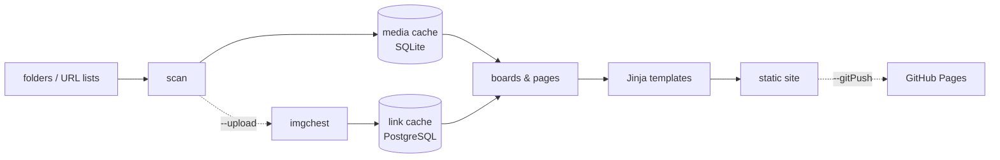

# pixBoards

[](https://github.com/flynnsharwood/pixBoards/actions/workflows/tests.yml)
[](https://pypi.org/project/pixboards/)
[](https://pypi.org/project/pixboards/)

**pixBoards turns folders of images and videos into a fast, static, Pinterest-style website.**
Point it at your picture folders and it builds paginated masonry and justified-layout galleries:
one board per folder, nested like the folders themselves.
- **Offline:** the output opens straight from disk.
- **Online:** with `--upload`, images go to an image host first, and the site can be pushed to
  GitHub Pages in the same run.

**[Live example →](https://flynnsharwood.github.io/exampleBoard/index.html)**

| Board index | Board page |
|---|---|
|  |  |

## Highlights

- **Two layouts, switchable per page:**
  - masonry columns;
  - a justified layout that fills every row edge to edge without cropping. Aspect ratios are
    computed in Python and written into the page, so there's no layout shift while images load.
- **Fast re-runs:**
  - an SQLite cache keyed on path, size and mtime stores each file's MD5, dimensions and EXIF
    date, so only new or changed files are read;
  - a warm rebuild of about 5,000 images takes about 0.3 s.
- **Hosting without hosting images:**
  - `--upload` sends new files to [imgchest](https://imgchest.com) and caches their links in
    PostgreSQL by content hash, so a file is never uploaded twice, even after it is renamed or
    moved;
  - `--gitPush` publishes the result to a GitHub Pages repo.
- **Viewer features:**
  - lightbox;
  - keyboard navigation (←/→ to change page, R for a random page, J to switch layout);
  - sticky toolbar with layout and size controls, remembered per browser;
  - board search;
  - optional "open on Pinterest" links for [gallery-dl](https://github.com/mikf/gallery-dl)
    downloads.
- **More ways to build boards:**
  - boards from text files of image URLs;
  - "recent" boards sorted by EXIF date (or by reddit post id);
  - random-sample boards;
  - links read from sidecar files.

## Quick start

```sh
pipx install pixboards               # or: pip install pixboards
pixboards --makeConfig               # writes config.yml (never overwrites)
# edit masterDir and directories in config.yml, then:
pixboards --recent 50 --random 100
```

Open `index.html` in the output folder. Install `pixboards[upload]` for the PostgreSQL, imgchest
and `.env` features.

## How it works



| Module | Role |
|---|---|
| `cli.py` | The only entry point that touches arguments, config, logging, the database and the network |
| `config_loader.py` | Defaults, CLI overrides, old key names, `~`/`$VAR` expansion and output paths |
| `mediacache.py` | Threaded hashing and image probing behind an SQLite cache |
| `boardmakers.py` | Folder scanning, upload, URL-list, recent and random boards |
| `imgchest.py` / `db.py` | Upload client and parameterised SQL; commits per upload, rolls back on errors |
| `create.py` + `templates/` | Autoescaped Jinja rendering and static CSS/JS |

### Engineering notes
- **No work at import time.** Configuration is passed explicitly, and every module can be
  imported and tested on its own.
- **Lazy optional dependencies.** psycopg2, requests and python-dotenv are imported only when
  needed, so the base install is just Jinja2, Pillow and PyYAML.
- **One record per file.** Each file is a single `MediaItem` dataclass, not parallel lists that
  can drift apart, so an uploaded link always stays with its file.
- **Safe SQL.** Table names go through `psycopg2.sql.Identifier`, and lookups are batched.
- **Token never exposed.** The GitHub token for `--gitPush` is passed through a git credential
  helper, never in a URL or a log line.
- **Tests and CI.**
  - 44 pytest tests cover config handling, the cache, board building, uploads (with a fake host),
    rendering and the CLI end to end.
  - ruff lint and format checks.
  - GitHub Actions runs everything on Python 3.10 and 3.13, and checks that the package builds.

## Usage

```
pixboards [--config FILE] [--dir DIR] [--upload [--useSaved] [--sidecar]]
          [--recent N] [--random N] [--reddit] [--useLists] [--gitPush] ...
```

| Flag | What it does |
|---|---|
| `--config FILE` | Use another config. The output folder is named after it |
| `--dir DIR` | Build from one folder instead of the configured `directories` |
| `--upload` | Use imgchest links, uploading files that aren't cached yet |
| `--useSaved` | With `--upload`: only use links already in the cache |
| `--sidecar` | With `--upload`: take links from `<image>.<ext>.txt` sidecar files |
| `--account NAME` | With `--upload`: which imgchest account(s) to use, in order |
| `--recent N` | Add a "recent" board with the newest N images (`-1` = all) |
| `--random N` | Add a board of N random images (`-1` = shuffle everything) |
| `--reddit` | With `--recent`: sort by reddit post id |
| `--useLists` | Also build boards from the `imageLists` URL files |
| `--gitPush` | Push the output to `remote_url` (token in `GITHUB_PAT`) |
| `--col`, `--height`, `--pageSize`, `--margin` | Override layout settings for one run |
| `--saveBoards` | Save board metadata to PostgreSQL |

Every config key is documented in [`config_example.yml`](config_example.yml).
- Logs go to `./logs/`.
- The media cache is `~/.cache/pixboards/media.sqlite3`.

### Several imgchest accounts

Put one key per account in `.env`; every variable is a separate account:
```sh
IMG_CHEST_API_KEY=...            # the "default" account
IMG_CHEST_API_KEY_MAIN=...       # an account named "main"
IMG_CHEST_API_KEY_2=...          # an account named "2"
IMG_CHEST_ACCOUNTS=main,default  # optional: the order to try them in
```
- If imgchest refuses a key (HTTP 401/403), the next account takes over and the file is retried.
- **Full accounts:**
  - a refusal about storage flags the account as full in the `imgchest_accounts` table, which
    imguploader shares;
  - later runs skip flagged accounts;
  - `imguploader accounts` lists the accounts and which are full;
  - `--flag-full` / `--unflag` change the flag by hand.
- imgchest's hourly upload limit (HTTP 429) applies to the whole connection, not one account, so
  it stops uploads for the run instead of switching accounts.
- Each link records which account it went to (the `account` column).

### Pinterest boards with gallery-dl

pixBoards 1.0.1 was developed and tested on Pinterest boards downloaded with gallery-dl (about
5,000 images in 60 folders).

1. Download your boards:

   ```sh
   gallery-dl --cookies cookies.txt https://www.pinterest.com/<your-user>/
   ```

   gallery-dl saves each pin as `pinterest_<pinId>[_n].<ext>`, in one folder per board and
   section.
2. Add the download folder to `directories` in your config and run pixBoards as usual. Each
   board becomes a pixBoards board, and each section becomes a nested board.
3. pixBoards links each image back to `https://www.pinterest.com/pin/<pinId>/`. To show the
   links, tick **Pinterest links** in the toolbar, or set `source_links: true` in the config.
   Each image then gets a hover badge, and the lightbox gets a link (or press **P**).

pixBoards only reads the file name, so keep gallery-dl's default naming; renamed files just get
no link. The links also work for `--upload` boards and for URL lists.

### Uploading a large library

For a first upload of thousands of files, use the companion bulk uploader,
[imguploader](https://github.com/flynnsharwood/imgUploader).
- It uploads one imgchest post per folder and can resume after an interruption.
- It fills the same `image_cache` table, so `pixboards --upload --useSaved` can use its links
  straight away.

## Development

```sh
git clone https://github.com/flynnsharwood/pixBoards.git && cd pixBoards
pip install -e ".[upload,test]" ruff
pytest -q
ruff check pixBoards tests scripts && ruff format --check pixBoards tests scripts
```

- `scripts/publish.sh` builds named profiles and pushes them to GitHub Pages. Its profiles live
  in `scripts/publish.conf`; start from `publish.conf.example`.
- `scripts/release.sh` builds, checks, uploads and tags a release.

## Project docs

- [CHANGELOG.md](CHANGELOG.md): what changed in each release
- [docs/tasks.md](docs/tasks.md): open and finished tasks
- [docs/1.0.1-report.md](docs/1.0.1-report.md): the 1.0.1 code review and what it fixed
- [docs/1.0.1-plan.md](docs/1.0.1-plan.md): next steps (storage layer, imguploader merge, index
  redesign)
